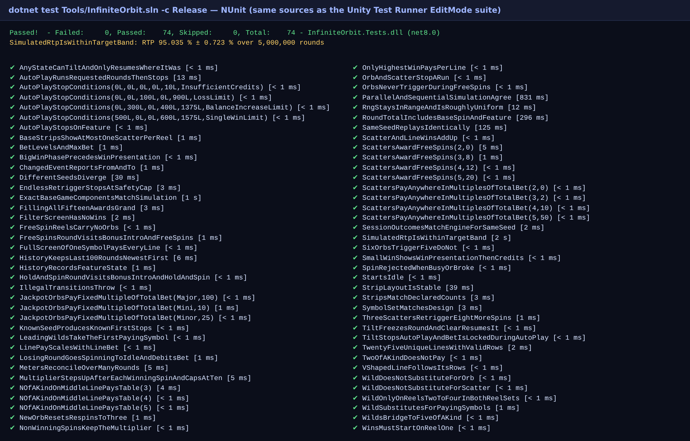
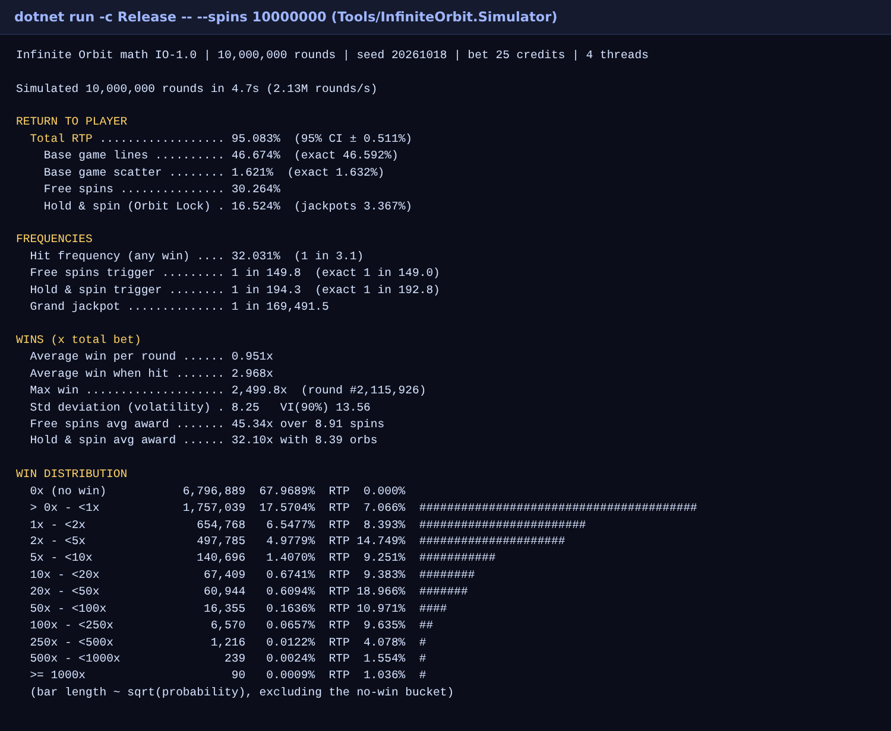
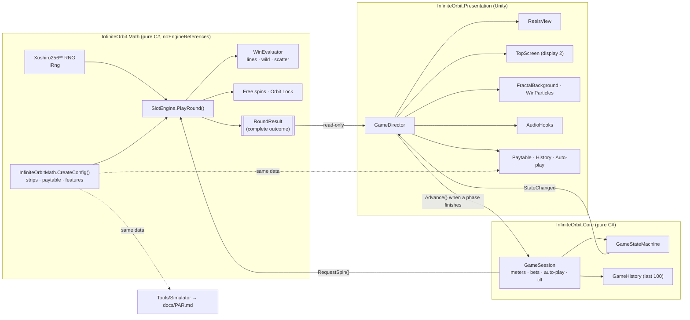

# Infinite Orbit — portfolio slot demo


A 5×3, 25-line video slot built the way a land-based studio structures a game: a certified-style **math
module** that decides every outcome, a **state machine** that walks the cabinet through the round, and a
**presentation layer** that only plays the result back. Original cosmic-fractal theme. **Fake credits only — no
real-money play.**

| | |
|---|---|
| RTP | **95.45%** (100M-spin simulation, ±0.16%) — target 94–96% |
| Hit frequency | 32.0% |
| Volatility | moderate-high (SD 8.4× bet, VI₉₀ 13.8) |
| Features | Free spins 8/12/20 with ×1→×10 multiplier · Orbit Lock hold-and-spin with Mini/Minor/Major/Grand |
| Max win seen | 3,069× bet |

Full numbers: [`docs/PAR.md`](docs/PAR.md). Design notes: [`DEVLOG.md`](DEVLOG.md).



## Setup

### Unity (the game)

1. Install **Unity 6** (6000.0 LTS) via Unity Hub. No extra packages are needed beyond `Packages/manifest.json`
   (Test Framework, uGUI, built-in modules).
2. *Add project from disk* → select this repository root. Unity generates `Library/` and `.meta` files on first import.
3. Press **Play** in any scene: `GameDirector` bootstraps itself (`RuntimeInitializeOnLoadMethod`) and builds the
   whole cabinet procedurally — no prefabs or imported art needed.
   Optional: **Infinite Orbit → Create Main Scene** saves `Assets/InfiniteOrbit/Scenes/Main.unity` and adds it to
   Build Settings for player builds.
4. Tests: **Window → General → Test Runner → EditMode → Run All** (same NUnit sources as below).

Controls: `Space` spin / skip · `↑`/`↓` bet · `M` max bet · `A` auto-play · `I` paytable · `H` history ·
`Q` effects quality · `T` simulate tilt (door open) · `C` attendant clear · `F1` add demo credits · `F12` screenshot.

With a second monitor connected, the top-box display (jackpots and celebrations) moves to display 2 automatically.

### .NET (math, tests, simulator — no Unity required)

Requires the .NET 8 SDK.

```bash
cd Tools
dotnet test InfiniteOrbit.sln -c Release                     # 74 NUnit tests
cd InfiniteOrbit.Simulator
dotnet run -c Release -- --spins 10000000                    # RTP, hit rate, feature odds, histogram
dotnet run -c Release -- --spins 100000000 --par ../../docs/PAR.md   # regenerate the PAR sheet
```



## Architecture



**The rule:** the outcome (stops, every win, every respin and free spin) exists in `RoundResult` before the state
machine leaves `Idle`. The presentation never calls the RNG; result properties have `internal` setters, so code
outside the math assembly cannot change them.

State flow per round:

```
Idle → Spinning → [BonusIntro → HoldAndSpin] → [BonusIntro → FreeSpins] → [BigWin] → [WinPresentation] → Idle
                          any state ──tilt──▶ Error ──attendant clear──▶ the interrupted state (round resumes unchanged)
```

## Repository layout

```
Assets/InfiniteOrbit/
  Scripts/Math/          RNG, reels, paytable, evaluator, features, simulation, exact analytics   (no Unity)
  Scripts/Core/          GameSession, GameStateMachine, AutoPlay, GameHistory                      (no Unity)
  Scripts/Presentation/  Unity: reels, HUD, top screen, panels, audio hooks, effects
  Tests/EditMode/        NUnit tests (run by Unity Test Runner and by dotnet test)
  Resources/InfiniteOrbit/  shaders; drop replacement audio in Audio/, art in Symbols/
  Editor/                menu items (create scene, quick 1M simulation)
Tools/
  InfiniteOrbit.Logic/            builds Math+Core from the Unity sources (netstandard2.1, C# 9)
  InfiniteOrbit.Tests/            runs the EditMode tests outside Unity
  InfiniteOrbit.Simulator/        Monte Carlo CLI + PAR generator
  InfiniteOrbit.UnityCompileCheck/ type-checks the Unity scripts against UnityEngine reference assemblies (CI)
docs/PAR.md                       generated PAR sheet
docs/screenshots/                 test/simulation captures (F12 in-game saves gameplay shots here)
```

## Replacing placeholders

* **Audio:** put clips named after a `SoundHook` (`ReelStop`, `ScatterAnticipation`, `FeatureEntry`, `BigWin`, …) in
  `Assets/InfiniteOrbit/Resources/InfiniteOrbit/Audio/`. Missing clips fall back to synthesized tones.
* **Symbol art:** put sprites named after a `Symbol` (`Pulsar`, `Wild`, `Orb`, …) in
  `Assets/InfiniteOrbit/Resources/InfiniteOrbit/Symbols/`.

## Status / known limits

* Math, session logic and tests are verified on every push (CI: `dotnet test`, simulator smoke run, Unity-script
  compile check).
* The Unity presentation was written and type-checked without a Unity editor available, so it has **not yet been
  play-tested in Unity 6** — expect some layout/tuning passes (text scale is one constant, `Ui.TextScale`). No
  gameplay screenshot is included for that reason; press `F12` in Play mode to capture one into `docs/screenshots/`.
* Jackpots are fixed multiples of the bet (no progressive pool). No real-money, persistence or networking.

## License

MIT — see [LICENSE](LICENSE). Theme, names and art are original.
